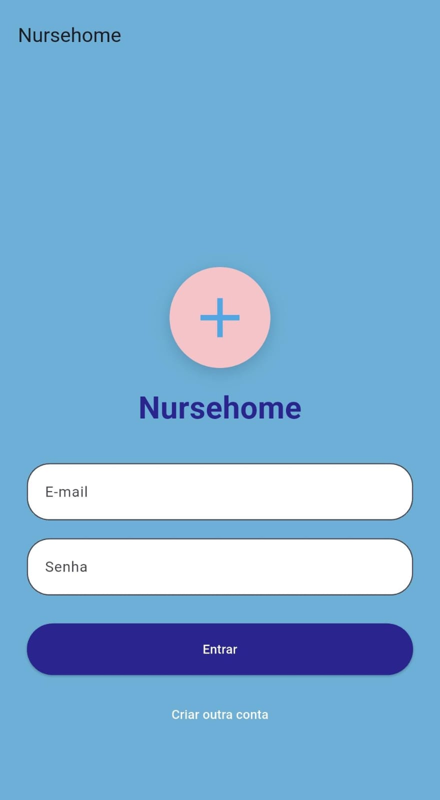
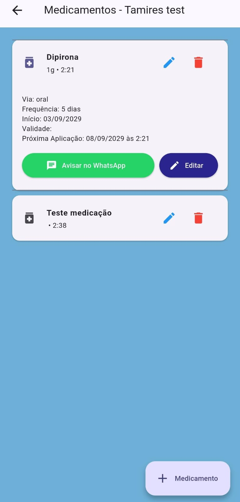
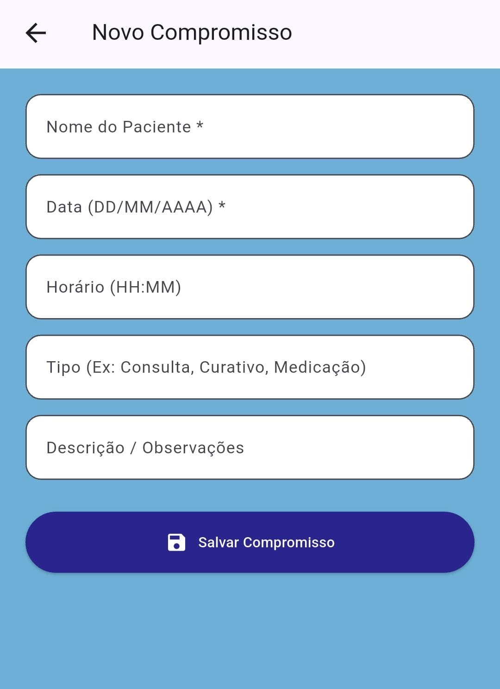
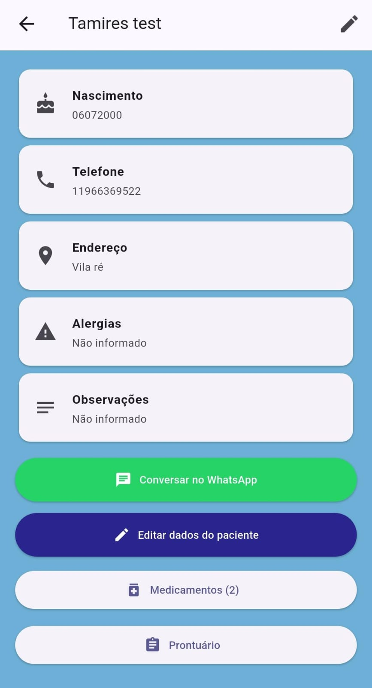

NURSEHOME > o nome foi criado pensado em enfermagem no lar/cuidado no lar.

O aplicativo foi desenvolvido pensando em práticas da rotina da enfermagem à domicílio.

Funcionalidades
- Cadastro e registro dos pacientes;
- Agendamento de lembretes de medicação com notificação local;
- Envio de mensagem via whatsapp diretamente para o paciente;
- Armazenamento local;

## 📱 Telas do app
| Login | Medicamentos |
|---|---|
|  |  |

| Agendamento | Prontuário |
|---|---|
|  |  |


Tecnologias
- Flutter/Dart
- `flutter_local_notifications` — notificações agendadas
- `shared_preferences` — persistência local
- `url_launcher` — integração com WhatsApp
- `timezone` — cálculo correto de horários das notificações

## 🚀 Como rodar o projeto

```bash
git clone https://github.com/tamiresolvr/nursehome.git
cd nursehome/flutter_application_1
flutter pub get
flutter run
```
## 📱 Plataformas suportadas

Android, iOS, Web, Windows, macOS e Linux (gerado pelo template padrão do Flutter).

## 📄 Licença

Projeto pessoal / educacional.
